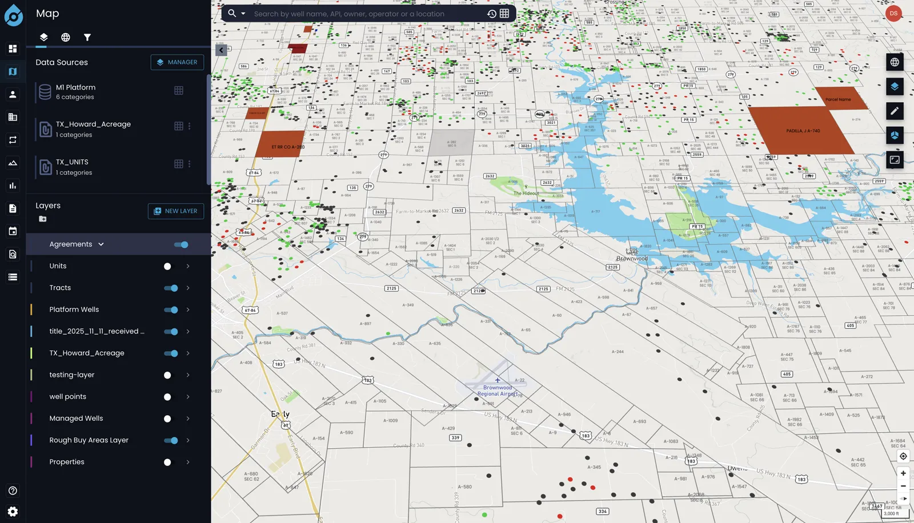

# danial-syed.netlify.app

My portfolio site: who I am, the products I've built, and a case-study page for each one with screenshots, what the product does, what I built, and the stack.

**Live:** https://danial-syed.netlify.app



## Stack

- React 19 with Vite (rolldown-vite)
- Tailwind CSS 4
- React Router 7 for the `/projects/:slug` case-study pages
- EmailJS for the contact form
- lucide-react icons
- Hosted on Netlify (`public/_redirects` sends every path to the SPA)

## How it's organised

```
src/
  data/projects.js     # every case study: copy, role, stack, image captions
  data/site.js         # page title and shared links (CV, GitHub, LinkedIn)
  pages/               # HomePage and ProjectPage
  sections/            # Hero, About, Projects, Experience, Testimonials, Contact
  components/          # Button, Lightbox and other shared pieces
public/projects/<slug>/  # cover.webp and screenshots for each case study
```

Adding a project means adding an entry to `src/data/projects.js` and its images under `public/projects/<slug>/`. The cards and the case-study page are generated from that entry.

## Run it locally

```bash
npm install
cp .env.example .env   # add the EmailJS keys for the contact form
npm run dev
```

`npm run build` builds to `dist/`, and `npm run lint` runs ESLint.

## Screenshots

Client screenshots on this site use demo data, or are blurred where they showed real names. The client code itself is private and isn't in this repository.
